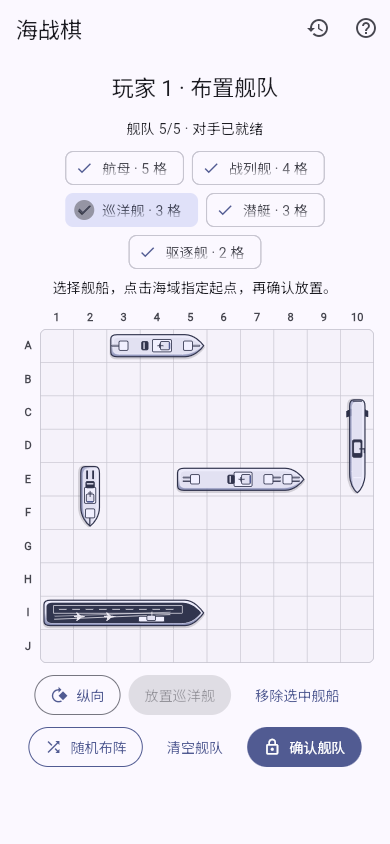
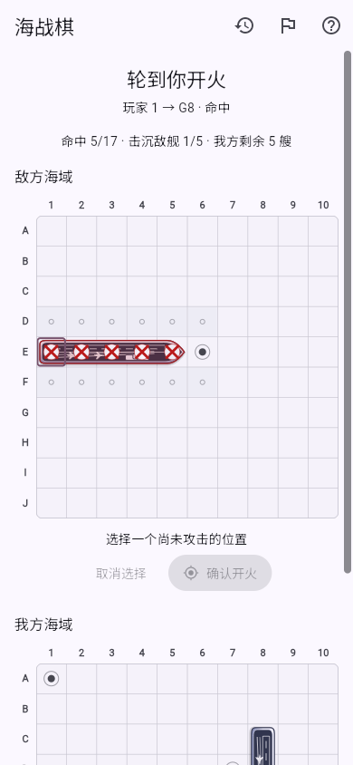

# EasyPlay

面向 Android 和 Web 的 Flutter 棋牌应用，支持围棋、国际象棋、跳棋、五子棋、中国象棋、三人斗地主和海战棋 Battleship。提供本地对战、设备本地 AI、Android 局域网房间及浏览器 WebRTC 对弈，无需账号或远程 AI 服务。斗地主支持三人对战，海战棋支持秘密布阵与双人侦察对战。

[下载 Android APK](https://github.com/chorusfruit-233/easyplay/releases/latest) · [打开 Web 版](https://chorusfruit-233.github.io/easyplay/)

## v1.7.7

- **斗地主逆时针轮转**：叫分和出牌统一按「自己 → 右侧下家 → 左侧上家」推进。
- **三视角座位修正**：每位玩家均以上家在左、下家在右显示；同机交接随当前玩家调整视角，单人 AI、LAN 和 WebRTC 共用一致布局。

[完整更新记录](https://github.com/chorusfruit-233/easyplay/compare/v1.7.6...v1.7.7) · [v1.7.7 下载与说明](https://github.com/chorusfruit-233/easyplay/releases/tag/v1.7.7)

## 支持的游戏

| 游戏 | 规则与功能 | AI |
| --- | --- | --- |
| 围棋 | 多套规则、SGF 棋谱、死子与计分、选点分析 | KataGo CPU；内置 b6，Android 可管理其他模型 |
| 国际象棋 | 标准规则、将军与终局判定 | Stockfish 19 |
| 跳棋 | 八种规则、PDN 棋谱库、完整行棋轨迹、AI 对抗观战 | 自研本地搜索，三档难度 |
| 五子棋 | 15×15 索索夫-8、黑方禁手、SGF/JSON 棋谱导出、AI 对抗观战 | Rapfi，三档难度 |
| 中国象棋 | 马腿、象眼、炮架、将帅照面、将死与困毙；固定亚洲长将/长捉配置 | Pikafish，六档难度 |
| 斗地主 | 54 张牌、叫分、全部常用牌型、地主与农民阵营；三人对战 | 本地 DouZero-WP，仅使用自己的手牌与公开信息 |
| 海战棋 | 经典 10×10、五艘舰船、隔格布阵、开火确认、击沉周边自动排除与同机遮挡 | 本地侦察 AI，仅依据自己的视图与公开结果 |

棋类游戏支持本地双人、AI 与联机。斗地主支持经典三人规则、同机遮挡交接、本地 DouZero-WP AI、三人 LAN / WebRTC 和两名真人加 AI 补位，详见 [斗地主说明](docs/DOUDIZHU.md)。中国象棋的着法历史仅用于当前对局的规则、悔棋、搜索和重连，不持久化保存棋谱；规则范围见 [中国象棋说明](docs/XIANGQI.md)。

海战棋支持单人 AI、同机双人、LAN 和 WebRTC。每回合开火一次，命中后也轮到对手，击沉全部五艘舰船获胜；舰船之间至少间隔一格（含斜角），击沉后自动标出周围空格。布阵和开火均需确认，舰船有各自的俯视外观，联机客人仅接收自己的舰队与公开结果。详见 [海战棋说明](docs/BATTLESHIP.md)。

五种棋类支持落子、移动和吃子动画，兼容系统减少动态效果设置，预览与细节见 [行棋动画](docs/BOARD_ANIMATIONS.md)。

跳棋支持英式/美式、国际、巴西、俄罗斯、Pool、意大利、西班牙、土耳其八种规则。跳棋和五子棋的 [AI 对抗观战](docs/AI_DUEL.md) 提供暂停、单步、悔棋和继续控制。

两种游戏的独立[棋谱库](docs/RECORD_LIBRARIES.md)保留全部对局，不按数量自动淘汰。跳棋支持 PDN 导入与导出；五子棋 SGF 用于交流正式落子和停着，JSON 保留交换、候选点等完整开局操作，当前尚无五子棋文件导入。

## 界面预览

 

 

  

## 安装与使用

- **Android**：从 Release 下载 `app-arm64-v8a-release.apk`，适用于 ARM64 设备；正式包沿用已有签名，可覆盖更新。v1.7.7 的构建号为23，ARM64 APK 的 versionCode 为2023。
- **Web**：直接打开上方 Web 版。AI 在浏览器本地运行，首次使用需要加载同源引擎和模型；围棋的跨源隔离由部署的 service worker 提供。
- **棋力刻度**：Stockfish 参考 Elo 和 Pikafish 相对档位的适用范围见 [棋力说明](docs/ENGINE_STRENGTH.md)，实际表现随设备、局面和思考时间变化。

## 联机

- **Android LAN**：创建口令房间，支持自动发现、手动加入和内置 Web 客户端。浏览器打开主机网页后可快捷加入，仍须输入口令，并等待主机开始对局。
- **浏览器 WebRTC**：手动交换邀请和回应，通过 STUN 建立直连，支持国内、国际及自定义服务。当前未启用自动信令或 TURN，部分网络无法直连。
- 房主验证走子；支持断线重连、状态同步、悔棋协商、认输和再来一局。双方须使用匹配的游戏规则，房间依赖主机持续运行。

## 开发与构建

使用 Flutter **3.44.0 / Dart 3.12.0** 及 Python 3；准备 Pikafish 发布资源还需要 `7z` 或 `7zz`。首次准备引擎时需要联网下载固定版本，脚本会校验 SHA-256。

```bash
flutter pub get
python3 tools/prepare_stockfish.py
python3 tools/prepare_pikafish.py
python3 tools/prepare_rapfi.py
python3 tools/prepare_douzero.py
flutter run -d chrome
```

构建并预览 Web（本地预览提供围棋 AI 所需的跨源隔离响应头）：

```bash
flutter build web --no-wasm-dry-run
python3 tools/serve_web.py --port 8080
```

构建包含棋类引擎、DouZero 模型和 LAN Web 客户端的 Android 测试包：

```bash
python3 tools/package_lan_android.py --debug
```

Android Studio / Gradle 构建也会自动准备 Stockfish、Pikafish、Rapfi、DouZero 和内置网页。原生引擎目标为 Android ARM64；KataGo 与 Web 构建的工具链说明见开发文档。正式 APK 使用 `python3 tools/package_lan_android.py` 构建，并须配置正式签名；仓库的发布工作流从 GitHub Secrets 读取签名配置。

```bash
flutter test
dart analyze lib test
```

## 文档

- [开发文档](docs/DEVELOPMENT.md)：结构、规则、平台构建与测试约定
- [AI 引擎与模型](docs/AI_ENGINES.md)：KataGo CPU、配置和模型管理
- [五子棋说明](docs/GOMOKU.md)：规则、AI、存储与联机
- [Rapfi 集成](docs/RAPFI.md)：固定引擎、模型、搜索预算与构建复现
- [棋谱库与导出](docs/RECORD_LIBRARIES.md)：PDN、SGF、完整 JSON 与跳棋轨迹
- [棋力标注](docs/ENGINE_STRENGTH.md)：Stockfish 参考 Elo 与 Pikafish 相对强度
- [AI 对抗观战](docs/AI_DUEL.md)：五子棋、跳棋双 AI 自动对弈与暂停、单步控制
- [斗地主说明](docs/DOUDIZHU.md)：固定规则、三人房间、手牌隐私与重连
- [海战棋说明](docs/BATTLESHIP.md)：经典规则、秘密布阵、本地侦察 AI、双人联机与重连
- [DouZero 接入](docs/DOUZERO.md)：WP 模型、设备本地推理、合法动作、许可与转换复现
- [AlphaDou 接入评估](docs/ALPHADOU.md)：权重公开情况、规则适配与移动端 / Web 路线
- [中国象棋说明](docs/XIANGQI.md)：固定规则、Pikafish、构建与模型许可
- [WebRTC 联机说明](docs/WEBRTC_MULTIPLAYER.md)：邀请流程、STUN 与网络限制

## 许可证

Copyright (C) 2026 chorusfruit-233

本项目以 **GNU 通用公共许可证第 3 版或更新版本**（GPL-3.0-or-later）授权发布，
全文见 [LICENSE](LICENSE)。你可以依据自由软件基金会发布的 GPL 条款重新分发
和/或修改本项目；本项目按“现状”提供，不附带任何明示或暗示的担保。

```
EasyPlay - 面向 Android 和 Web 的棋类应用
Copyright (C) 2026 chorusfruit-233

This program is free software: you can redistribute it and/or modify
it under the terms of the GNU General Public License as published by
the Free Software Foundation, either version 3 of the License, or
(at your option) any later version.

This program is distributed in the hope that it will be useful,
but WITHOUT ANY WARRANTY; without even the implied warranty of
MERCHANTABILITY or FITNESS FOR A PARTICULAR PURPOSE.  See the
GNU General Public License for more details.

You should have received a copy of the GNU General Public License
along with this program.  If not, see <https://www.gnu.org/licenses/>.
```

### 第三方组件

引擎代码与模型权重分别遵循各自许可证；EasyPlay 的 GPL 授权不替代第三方资源授权。

| 组件 | 许可证 | 用途 |
| --- | --- | --- |
| [KataGo](https://github.com/lightvector/KataGo) | MPL-2.0 | 围棋 CPU 引擎，Android ARM64 原生程序与 WebAssembly Worker |
| [Eigen](https://gitlab.com/libeigen/eigen) | MPL-2.0 | KataGo 的 CPU 后端 |
| KataGo 神经网络 b6 | CC0-1.0（公有领域） | 内置 g170 b6 权重 |
| [Stockfish 19](https://github.com/official-stockfish/Stockfish) | GPL-3.0 | 国际象棋引擎，Android ARM64 与 Web Worker |
| [Pikafish](https://github.com/official-pikafish/Pikafish) | GPL-3.0-or-later | 中国象棋引擎，Android ARM64 与 WebAssembly Worker |
| Pikafish NNUE 权重 | 单独授权，未经许可不得商业使用 | 中国象棋 AI 网络，见 [模型许可](assets/pikafish/NNUE-License.md) |
| [Rapfi](https://github.com/dhbloo/rapfi) | GPL-3.0-or-later | 五子棋引擎，Android ARM64 与 WebAssembly Worker |
| [Rapfi 连珠网络](https://github.com/dhbloo/rapfi-networks) | CC0-1.0（公有领域） | 连珠黑、白网络及 classical 模型，见 [Rapfi 说明](docs/RAPFI.md) |
| [DouZero](https://github.com/kwai/DouZero) / DouZero-WP 模型镜像 | Apache-2.0 | 斗地主三个身份模型，来源与哈希见 [DouZero 说明](docs/DOUZERO.md) |
| [ONNX Runtime](https://github.com/microsoft/onnxruntime) | MIT / 第三方组件许可 | DouZero Android CPU 与 Web WASM 推理 |
| cpp-httplib、half、filesystem 等 | Apache-2.0 / BSD / MIT 等 | KataGo 依赖，原文见 `assets/katago/THIRD-PARTY-LICENSES/` |

许可证及来源归档在 `assets/katago/`、`assets/licenses/`、`assets/pikafish/`、`assets/rapfi/`、`assets/douzero/`、`docs/licenses/`、`web/stockfish/`、`web/rapfi/` 和 `web/douzero/`。应用内「关于与许可证」页面提供引擎与模型的许可信息。
