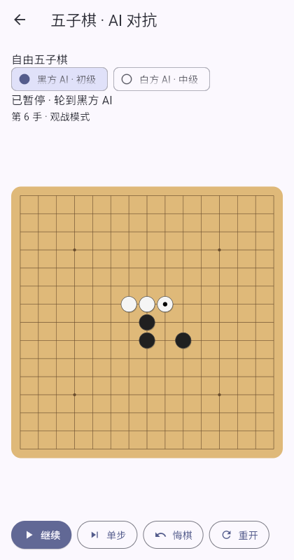
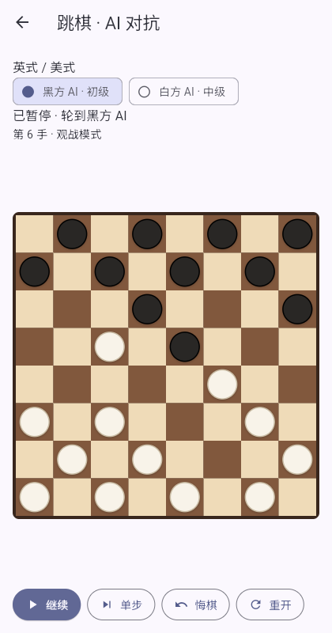

# 五子棋与跳棋 AI 对抗

在五子棋或跳棋首页进入「AI 对抗」，分别设置黑方、白方 AI 的初级、中级或高级难度，点击「开始观战」。两名 AI 在设备本地自动对弈。五子棋使用 Rapfi，Android 随包提供模型，Web 首次使用加载同源模型；规则为索索夫-8，AI自动完成指定开局、两次交换、声明1–8打与候选选点；双方难度绑定开局棋手，交换后随棋手保留，页面显示当前所执颜色。跳棋支持全部八种规则，并遵循各规则的先手规定。

- **暂停 / 继续**：暂停会取消当前思考，继续时从当前局面重新搜索。
- **单步**：暂停时推进一个操作，完成后仍保持暂停。五子棋开局包括交换、数量声明、给点和选点；跳棋的连续吃子算一手。
- **悔棋**：撤回一次操作并暂停，方便分析；对局结束后也可悔棋。
- **重开**：确认后沿用规则和双方难度，新建对局，旧局保留在棋谱库中。原先暂停时，新局也保持暂停。
- 棋盘仅供观战，点击棋盘不会替 AI 行棋。当前行棋方会高亮显示。

每次行棋后留出 700 ms 再开始下一方思考，让落子、移动和连续吃子动画完成。胜负或规则和棋产生后自动停止。切到其他应用时取消当前搜索；返回时仅自动恢复此前运行中的对局，手动暂停的对局保持暂停。退出页面立即停止自动行棋，迟到的搜索结果不能更改棋盘或存档。

重开后，五子棋可采用不同的合法指定开局；Rapfi 的较低强度和跳棋的同分候选会在走法间变化，避免总是重复同一盘棋。唯一正确的防守与获胜应手仍按搜索结果执行，对局胜负由实际行棋决定。

对局自动保存双方难度、规则、完整局面及结果。「棋谱库」可恢复、导出或确认删除，恢复后先暂停，点击「继续」或「单步」接着观战。重开使用新记录 ID，保存操作串行执行。导出格式见 [棋谱库说明](RECORD_LIBRARIES.md)。

五子棋沿用 `easyplay.gomoku.records.v1` 存储键，AI 对抗记录使用外层版本 2 和 `aiDuel: {blackLevel, whiteLevel}`；原有本地/人机记录继续使用外层版本 1，新局面使用版本4与soosyrv8，旧版3与professional只读打开，记录交换、候选与选点操作；旧局面保留为只读历史。跳棋沿用原存储键和记录版本，以 `kind: aiDuel` 及同名 `aiDuel` 设置区分模式。原有存档继续读取；不完整或未知的对抗难度会被拒绝。

共用调度和观战控件位于 `lib/ai/`，各游戏适配器位于各自模块的 `*_ai_duel.dart`。`test/ai/` 覆盖交替行棋、双方难度、动画间隔、暂停与迟到结果、单步、悔棋、重开、生命周期、退出、胜负停止、索索夫-8开局与两次身份交换、旧五子棋存档兼容和八种跳棋规则的存档恢复，以及横竖屏交互。

`flutter build web` 后运行 `node tools/test_ai_duel_web.cjs`，可通过真实发布版页面回归自动行棋、双方难度、暂停、单步、悔棋、重开及浏览器存储。设置 `CAPTURE_AI_DUEL=1` 会更新下方截图。

