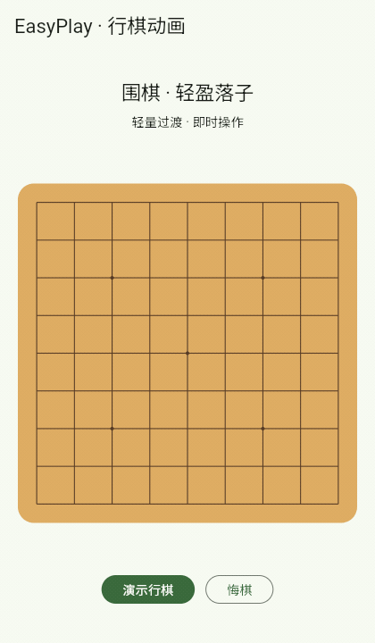
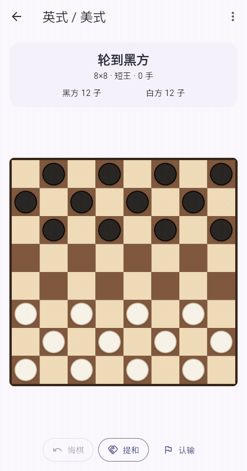
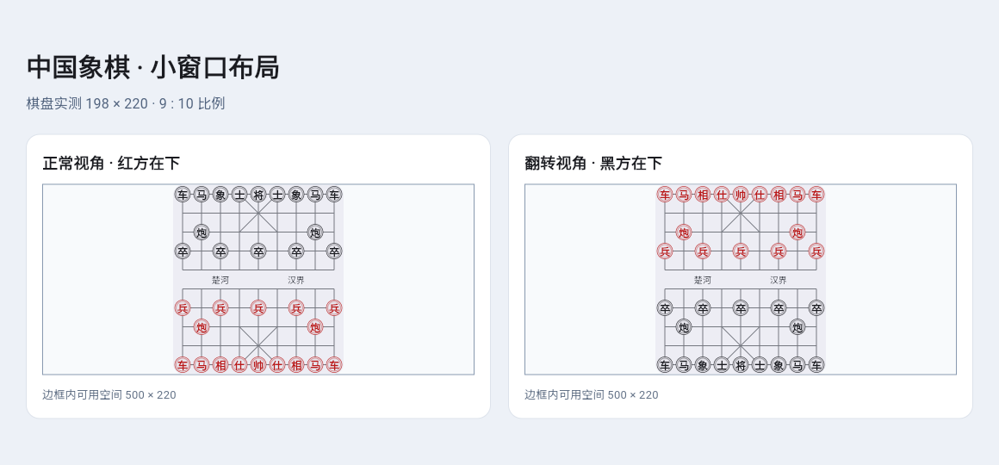

# 行棋动画

五种棋类共用轻量动画，适用于本地双人、AI 和联机对局。

| 游戏 | 显示效果 |
| --- | --- |
| 围棋、五子棋 | 棋子以短暂的缩放和淡入落下；围棋提子淡出 |
| 国际象棋 | 棋子平滑移动，吃子淡出；王车易位同时移动两子，兵到达后显示所选升变棋子；吃过路兵在实际被吃的位置淡出 |
| 中国象棋 | 棋子沿起点至终点移动，被吃棋子淡出 |
| 跳棋 | 沿实际连跳路径逐段移动，经过被吃棋子后淡出，走完后显示升王结果 |

落子约 180 毫秒，普通移动约 240 毫秒，连续跳吃随路径延长，最多 600 毫秒。系统开启“减少动态效果”时直接显示结果。动画期间仍可操作，规则和回合立即提交；AI 快速应手或网络连续更新时不排队播放旧局面。

悔棋、重开、读档、批量同步、翻转棋盘和切换规则会直接对齐当前局面。切入后台或棋盘所在页面停用时结束当前过渡，返回后不补播。调整窗口大小时继续按棋盘坐标定位。

## 预览

下面使用实际棋盘控件录制，为便于观察放慢至 3 倍；产品中使用上述正常时长。



下面录自修复后的实际跳棋对局页面，棋子移动使用正常时长：



## 实现与验证

`lib/widgets/board_motion.dart` 只维护显示快照，按连续的一手记录生成过渡。围棋、五子棋、国际象棋和中国象棋通过 painter 的 repaint 通知重绘棋子，避免每帧重建输入控件；跳棋使用不拦截点击的棋子叠层。没有新增对局存储、网络消息或动画等待逻辑。

跳棋还会静态显示上一手的完整轨迹，包含连续吃子的方向箭头和每个落点；轨迹随翻转、悔棋、恢复和重开更新，在减少动态效果模式下仍保留。详见 [棋谱库与上一手轨迹](RECORD_LIBRARIES.md)。

对局页面必须保留棋盘控件的状态，不能用每手变化的 `revision` 或联机 `seq` 作为棋盘的 Key，否则上一局面会丢失，新着手只会立即显示终点。围棋的落子预览和手势在局面变化时单独清除，不依靠重建棋盘重置输入。页面回归会操作实际跳棋对局及围棋、五子棋、跳棋联机页面，检查本方与对手着手的动画中间帧。

围棋使用 `GameSession.stateRevision` 识别走子、摆子、认输、计分和悔棋等状态变化；原有 `revision` 只代表初始记录代际，用于保留导入 SGF 的兄弟变例。围棋联机页面按已提交序号复用显示快照，避免双击或滑动确认的预览被普通重建清空；完整同步与断线会取消旧预览。退出计分阶段时清除本地死子标记。

动画路径和吃子时间保存不可变快照。空单路径、相邻重复点、过量或重复吃子目标会被拒绝；空路径集合、单点落子和合法绕圈连跳仍受支持。吃子时间限制在 `0..1`，非有限值按 `0` 处理，终点吃子在最终局面到达时移除。

中国象棋同时遵守父容器的宽高限制，保持 `9:10` 比例；小窗口和翻转棋盘的点击坐标通过控件测试验证。

围棋和中国象棋按实际指针坐标确定交点，不注册缺少坐标的整盘语义点击。浏览器启用无障碍语义时，快速点击非中心交点仍使用真实坐标，避免被转换成棋盘中心点击；浏览器回归同时覆盖这两种棋盘。



```sh
dart analyze lib test
flutter test
flutter build web --release --no-wasm-dry-run --base-href /easyplay/ \
  --target test/lan/rtc_browser_smoke.dart --output build/rtc-smoke
node tools/test_rtc_web.cjs
flutter build web --release --no-wasm-dry-run --base-href /easyplay/ \
  --target test/board_motion_browser_smoke.dart --output build/board-motion-smoke
node tools/test_board_motion_web.cjs
python3 tools/package_lan_android.py --debug
```

新增测试覆盖落子与吃子中间帧、快速应手、悔棋/重开、批量同步、翻转、减少动态效果、后台恢复、易位、吃过路兵、升变和连跳。原有国际象棋像素回归在动画结束后比较完整画面与全新棋盘，继续检查空格和被吃棋子不残留。浏览器 smoke 使用五种实际棋盘控件与真实按钮，并通过系统媒体查询验证减少动态效果；测试入口不加入产品构建。

WebRTC 浏览器回归通过真实双端围棋页面验证：首次点击只预览，二次点击提交并同步，对手应手后双方协商悔棋。设置 `CAPTURE_RTC_GO=1` 可保存首次点击的预览截图。
