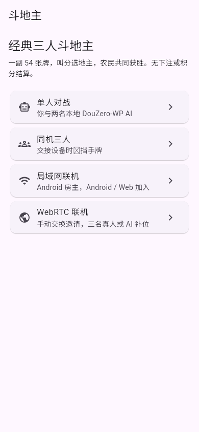
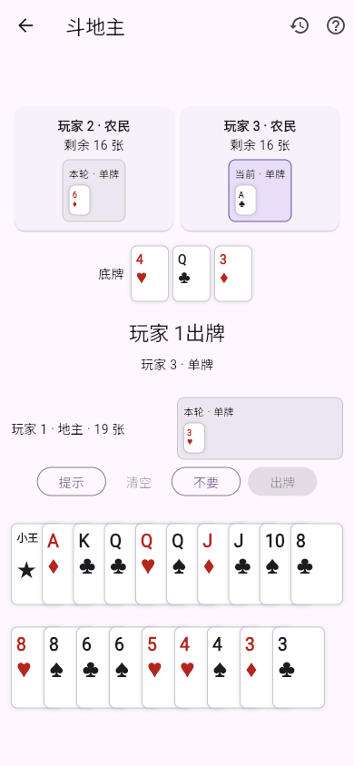

# DouZero-WP 斗地主 AI

单人对战、房间 AI 补位与跟牌「提示」默认使用 **DouZero-WP**，在设备本地计算。WP 以胜率为训练目标，应用没有引入计分或倍率。原版 DouZero 不包含叫分模型，叫分继续使用现有手牌评估策略。领出不显示提示按钮。

 

## 固定模型与来源

- [kwai/DouZero](https://github.com/kwai/DouZero)，源码 commit `718a5c920bf3361e34178a38f3b80458e176b351`，Apache-2.0。
- 三个 WP 检查点来自 Apache-2.0 仓库 [pineoncellar/DouZero_API](https://github.com/pineoncellar/DouZero_API/tree/ca8c841552e08d602ad326d2c7450b683bf41226/baselines/douzero_WP)，固定 commit `ca8c841552e08d602ad326d2c7450b683bf41226`。Git blob 与 `tianqiraf/DouZero_For_HappyDouDiZhu@c01062592f362cfb77d6af14a34c2cbcfa614fd2` 的对应文件一致。
- 上游 README 的 Google Drive 下载目录在 2026-10-18 核对时返回 404，因此采用上述公开镜像，未声称从失效的官方目录重新验证下载。没有使用 AlphaDou 仓库的测试权重。
- 原始检查点、导出文件的 SHA-256、大小和特征维数见 [manifest.json](../assets/douzero/manifest.json)。三个 float32 ONNX 模型合计 17,965,221 字节，未量化、未重新训练。

| 身份 | 模型 | 每个候选动作的特征数 |
| --- | --- | --- |
| 地主 | `landlord.onnx` | 373 |
| 地主上家（地主之前行动） | `landlord_up.onnx` | 484 |
| 地主下家（地主之后行动） | `landlord_down.onnx` | 484 |

按实际地主座位映射相对身份，支持任意座位成为地主。模型是 128 维 LSTM 加五个 512 维隐藏层，历史输入为最近 15 次行动组成的 `1×5×162` 张量；「不要」也占一次历史行动，不足 15 次在前面补零。

## 信息与规则边界

`DouZeroFeatures` 只接收 `DouDizhuPlayerView`，不接触权威 Session、其他玩家私有手牌、牌堆或洗牌种子。

- 点数按 13 列、每列四位的重复次数编码，另两位表示大小王。花色不影响评分；候选动作始终保留当前手牌的实体 ID。
- 未知牌集合由整副牌减去自己的手牌和全部公开出牌得到，不猜测真实私有分配。底牌不单独扣除，它们已包含在当前手牌或公开出牌中。
- 各身份已出牌、最近行动（包括不要）、剩余张数、炸弹次数与历史顺序均从公开记录重建。连续两人不要后当前目标为空，历史仍保留两次不要。
- 所有候选动作由应用的 `LegalPlayGenerator` 生成；跟牌时加入合法的不要，领出时不加入。模型只评分这些动作，不输出未经规则验证的新牌组。即使模型近似评分有误，也优先选择合法的一手出完。

EasyPlay 对飞机单翅膀的不同点数、主体点数、双王附件等限制比上游部分牌型更严格。接入保留应用现有经典规则，按这些规则约束动作；训练分布与应用规则并非完全相同，不能直接套用论文胜率或宣称必胜。

## 运行与故障处理

Android 使用 `com.microsoft.onnxruntime:onnxruntime-android:1.22.0`，在专用串行执行线程推理。Web 使用 npm `onnxruntime-web@1.22.0` 的本地 WASM，在独立 Worker 中推理。三个身份的会话按需加载并缓存，每次最多处理 128 个候选动作；每批只编码一次公共历史。Android / Web 均使用单线程 CPU，无云端请求。模型和运行时随包分发，浏览器仅从应用同源地址获取资源，支持嵌入 APK 的 LAN 网页及子路径部署。

Web 不依赖 SharedArrayBuffer；普通 LAN HTTP 没有 WebCrypto 时，Worker 使用本地 SHA-256 校验模型。两类联机服务器均为 `.mjs` 返回 JavaScript 类型。空闲一分钟后 Worker 释放，下一次请求再按需加载；Android 会话随 Activity 销毁释放。

模型缺失、校验失败、推理异常或旧版房主缺少公开历史时，会显示「DouZero 暂不可用，已使用本地兼容策略」，并使用原有合法出牌策略继续游戏。自动重试间隔 30 秒，也可点击「重试 DouZero」。房间 AI 由房主计算，故障提示显示在执行推理的房主设备；客人的本地提示独立计算。未提供 DouZero 原生运行时的平台使用兼容策略，首页按实际可用后端标注。

AI 结果仍受原有回合版本与连接状态检查；退出、重连或回合变化后的过期结果不会提交。规则、联机消息和存储格式未变。

## 复现与验证

常规构建无需 Python / PyTorch，只需验证已提交的 ONNX 文件并准备固定 Web 运行时：

```sh
python3 tools/prepare_douzero.py
flutter test test/doudizhu/douzero_test.dart test/doudizhu/ui_test.dart
node tools/test_douzero_web.cjs
flutter build web --release --no-wasm-dry-run --base-href /easyplay/ \
  --target test/doudizhu/rtc_browser_smoke.dart --output build/doudizhu-smoke
node tools/test_doudizhu_web.cjs
python3 tools/package_lan_android.py --debug
cd android && ./gradlew :app:testDebugUnitTest --no-daemon
```

重新导出时，在 Python 3.12 虚拟环境安装 `tools/requirements-douzero.txt` 的固定版本；Torch CPU wheel 使用 `https://download.pytorch.org/whl/cpu` 索引，其他依赖使用 PyPI。运行 `python tools/export_douzero.py`：下载并校验源码与检查点，完整严格加载所有参数，导出 ONNX opset 17，并与原版 PyTorch 在 1、3、17、129 个候选动作下比较评分与最佳动作。首次核对的最大绝对误差低于 `0.000008`。修改导出结构后须重新核对 `manifest.json` 和参考用例。

原版环境参考的生成步骤：

```sh
dart run tools/generate_douzero_cases.dart > build/douzero/cases.json
python tools/generate_douzero_reference.py --source /path/to/pinned/DouZero
```

该工具先以完整初始发牌在原版 `GameEnv` 回放，核对行动座位、牌权和剩余张数，再调用原版 `get_obs` 与 PyTorch 模型；测试中的完整发牌仅供离线参考生成，未传入产品 AI。16 个参考包含三个地主座位、三个模型身份、不要、两次不要后的领出、炸弹及超过 15 次的历史。Dart 与浏览器分别核对完整特征哈希和原版评分，Android 所用推理类通过真实 JNI 核对，并覆盖 128 / 256 的分批边界及损坏模型拒绝。

浏览器兼容测试还模拟普通 LAN HTTP 的功能条件：关闭 WebCrypto、SharedArrayBuffer 与跨源隔离后，重跑全部参考、损坏模型拒绝和重试。该模拟不等同于实体手机上的非安全来源实测；Android 本次验证为构建与同一推理类的桌面 JNI 运行。

许可证、模型来源及变更说明位于 `assets/douzero/`，并可从应用「关于与许可证」查看。
