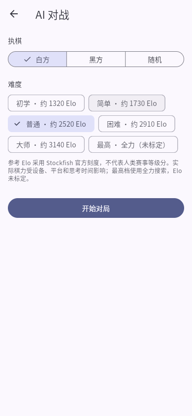
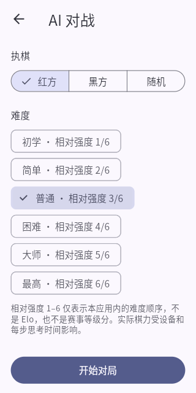

# Stockfish 与 Pikafish 棋力标注

难度选择页和对局页使用相同标注。标注仅帮助选择对手，不改变原有搜索参数、着法规则或存储格式。

## Stockfish 19：参考 Elo

| 难度 | Skill Level | 每步思考预算 | 显示的参考棋力 |
| --- | --- | --- | --- |
| 初学 | 0 | 150 ms | 约 1320 Elo |
| 简单 | 3 | 250 ms | 约 1730 Elo |
| 普通 | 7 | 400 ms | 约 2520 Elo |
| 困难 | 12 | 700 ms | 约 2910 Elo |
| 大师 | 17 | 1000 ms | 约 3140 Elo |
| 最高 | 20 | 1500 ms | 全力（未标定） |

数值来自固定 Stockfish 19 提交的 [Skill 映射](https://github.com/official-stockfish/Stockfish/blob/edb0d9db6731067ec50ce619ff372b463bc4dd5d/src/search.h#L247)。上游以 Stash 对局结果拟合 CCRL Blitz Elo 参考刻度，Skill 0～19 对应约 1320～3190。对现有 Skill 值反解下式，再四舍五入至十位；Skill 0 使用官方下限 1320。

```text
e = (Elo - 1320) / (3190 - 1320)
skill = clamp(((37.2473 * e - 40.8525) * e + 22.2943) * e - 0.311438, 0, 19)
```

Skill 20 关闭技能降级，超出上述标定区间，因此显示“全力（未标定）”，不编造最高档 Elo。应用继续使用原有 Skill Level 与 movetime 设置，没有启用 UCI_Elo 限强。

这些数值不是 EasyPlay 的实测等级分，也不等同于 FIDE、Chess.com 或 Lichess 评分。设备速度、短思考预算、局面及平台都会影响实际表现；Web 使用较小的 NNUE，与 Android 不能保证同等棋力。



## Pikafish：相对强度

| 难度 | 显示的相对强度 | 每步思考预算 |
| --- | --- | --- |
| 初学 | 1/6 | 150 ms |
| 简单 | 2/6 | 250 ms |
| 普通 | 3/6 | 400 ms |
| 困难 | 4/6 | 700 ms |
| 大师 | 5/6 | 1000 ms |
| 最高 | 6/6 | 1500 ms |

固定的 [Pikafish 2026-09-06 选项](https://github.com/official-pikafish/Pikafish/blob/4c17cee11f888ae1d48a9494f2e2239f019f0a1f/src/engine.cpp)没有 Skill Level、UCI_LimitStrength 或 UCI_Elo，实际难度差别来自每步思考预算。相对强度 1～6 只表示本应用内从低到高的档位顺序，不是 Elo、棋手段位或赛事等级分，不代表等距的棋力提升，不能与 Stockfish 的分数比较。

实际棋力仍受设备和局面影响，更长预算不保证每一步都更好。设置页同时显示“不是 Elo”的说明，避免将相对档位误认为已标定评分。


