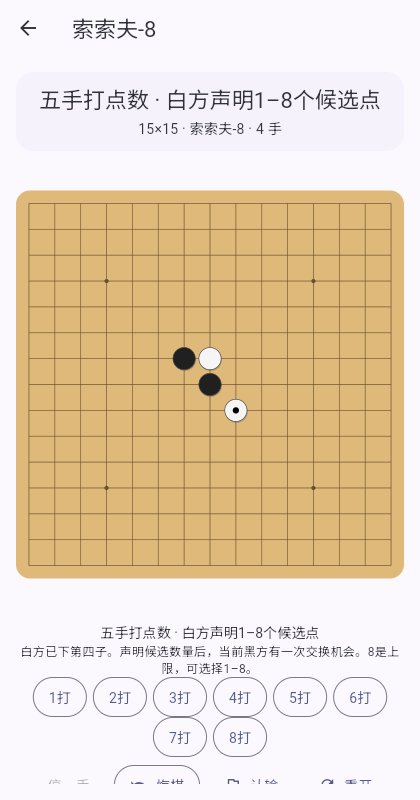
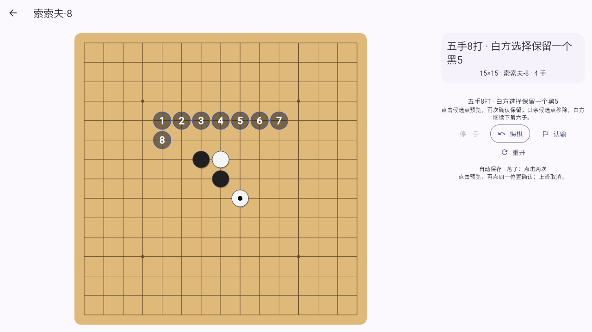

# 五子棋：索索夫-8

新对局统一采用 15×15 [RIF Soosõrv-8（索索夫-8）规则](https://www.renju.net/rule/24/)。本地双人、人机、AI 观战、Android LAN 和浏览器 WebRTC 共用同一规则核心。

| 阶段 | 操作者与操作 |
| --- | --- |
| 指定开局 | 开局执黑者连续摆黑1、白2、黑3。黑1在天元，白2在中心3×3，黑3在中心5×5，均为空点；归并旋转和镜像后为26种开局。 |
| 第一次交换 | 开局执白者选择是否交换颜色。棋子保持原位。 |
| 第四手 | 当前白方在任意空点落白4。 |
| 声明打点数 | 下白4的棋手声明黑5候选数 N，范围 **1–8**。8是上限，不是每局必须8打。 |
| 第二次交换 | 当前黑方已知白4和 N，再选择是否交换颜色。 |
| 提出候选 | 最终黑方提出 N 个合法、互不重复且不同形的黑5候选点。判断同形要保持前四子的颜色与位置。候选不计入正式棋步。 |
| 选点与第六手 | 最终白方保留一个候选为正式黑5，移除其余候选；同一棋手随后下白6。 |
| 正常行棋 | 双方轮流下子。黑方恰好五连获胜；白方五连或长连获胜。 |

两次交换都会改变棋手所执颜色；交换两次后回到原颜色。人机难度、观战难度和联机身份始终绑定开局棋手，不随棋子颜色混淆。

黑方禁长连、四四和三三，活三扩展递归检查以排除假活三。同一活四的两个成五点只算一个四，同方向也可能有双四。应用在确认落下禁手时立即判黑负；同手形成五连时优先判黑胜。定义和优先级参照 [RIF 连珠规则](https://www.renju.net/rifrules/)。正常阶段可以停一手，双方连续停一手判和；开局不能停一手。认输按当前所执颜色判定。应用不包含赛事编排、比赛时钟和人工裁判申诉。

## 操作与 AI

默认先预览，再点同一交点确认；点别处调整，上滑取消。开局摆子、候选点与白方选点都采用相同确认方式，预览不会保存、触发 AI 或发送联机操作。可在设置中更改落子方式。

页面显示阶段与操作方。白4后提供1打到8打按钮；第二次交换会显示已声明的数量；候选编号单独绘制，选定后只留下正式黑5。逐操作悔棋可撤回声明、任一次交换、候选或选点，恢复正确操作方。





人机与 AI 观战的三档难度均使用 **Rapfi**。Android 引擎和模型随 APK 提供；Web 首次使用加载同源模型，全部在设备本地推理。初级/中级/高级对应 Rapfi 强度10/60/100和正常每步100/700/2400 ms预算，不标注 Elo。开局在26种合法棋形内变化，Rapfi 参与交换、白4、候选数量、提出候选和白方选点。具体搜索与近似范围见 [Rapfi 说明](RAPFI.md)。旧 Dart 搜索保留作历史回归，不用于产品对局。

退出、悔棋、弹窗、后台和重开会取消旧搜索。回前台后按当前棋手继续；旧结果不能落到新局面。AI 观战支持暂停、单步、悔棋和续局；单步推进一个操作，声明数量也算一次。详见 [AI 观战说明](AI_DUEL.md)。

## 保存与联机兼容

本地、人机、观战在正式操作后保存，仍用 `easyplay.gomoku.records.v1`，最多100条，本机存储。新局面是 **version 4 / variant soosyrv8**，记录带棋手身份的全部动作。恢复时重放并验证声明范围、交换时机、候选、选点和结果；任何开局阶段都可续局。

旧 version 3 / professional（五手两打）及 version 1、2 存档按原规则读取，在首页只读打开；不重新解释、不批量改写，不允许从旧存档续下或重开旧规则。损坏记录不影响其他有效存档。

联机总协议版本仍为3，五子棋配置改为 `game: gomoku`、`rulesVersion: 4`、`boardSize: 15`、`variant: soosyrv8`。旧五子棋配置或缺失字段拒绝连接，其他棋种协议不变。交换和数量声明分别使用 `gomokuExchange` / `gomokuDeclare` 事件；候选和选点按阶段解释落子消息。权威房主验证认证身份与操作次序，重连重放完整事件；悔棋需对方同意，重赛清空两次交换与数量状态。

## 开发验证

```bash
python3 tools/prepare_rapfi.py
flutter test
dart analyze lib test
flutter build web
node tools/test_rapfi_web.cjs
node tools/test_gomoku_placement_web.cjs
node tools/test_ai_duel_web.cjs
python3 tools/package_lan_android.py --debug
```

`soosyrv8_test.dart` 覆盖两次交换的四种组合、N=1–8、逐操作恢复/悔棋及防伪。`rapfi_player_test.dart` 验证完整 MultiPV 轮次、N选择、限制候选、白6选点、错误与取消重建。原生和真实浏览器回归见 [Rapfi 验证](RAPFI.md)。`professional_test.dart` 保留旧版规则/棋谱回归；页面、LAN 和 WebRTC 回归使用新规则。
