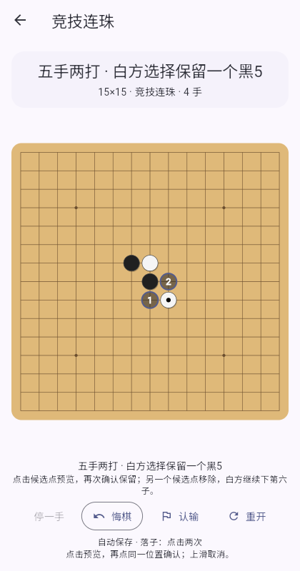

# 五子棋

## 竞技连珠

新对局统一使用 15×15 竞技连珠，开局采用[《中国五子棋竞赛规则（2025年版）》第 11.2 条“五手两打开局”](https://www.sport.gov.cn/qpzx/n5384/c29225839/part/29225929.pdf)。本地双人、人机、双 AI 观战、Android LAN 和浏览器 WebRTC 使用相同规则。

| 阶段 | 操作者与操作 |
| --- | --- |
| 指定开局 | 开局执黑者连续摆出黑1、白2、黑3。黑1在天元，白2在中心3×3区域，黑3在中心5×5区域，均须为空点；旋转与镜像归并后对应26种开局。 |
| 三手交换 | 开局执白者选择“交换执棋”或“不交换”。交换改变棋手所执颜色，不移动棋盘上的棋子。 |
| 第四手 | 当前执白者在任意空点落白4。 |
| 五手两打 | 当前执黑者给出两个不同形的黑5候选点。候选点单独显示，不计入正式棋步；判断同形时考虑前四子和棋子颜色。 |
| 选点与第六手 | 当前执白者选择保留一个候选点作为黑5，另一个移除；同一棋手随后落白6。 |
| 正常行棋 | 双方轮流落子。黑方恰好五连获胜，白方五连或长连获胜。 |

黑方有长连、四四、三三禁手；活三的扩展递归检查禁手，排除假活三。四四按不同四子组合计数，同一活四的两个成五点只算一个四，同方向也可形成双四。确认落下禁手时应用立即判黑方负；同手形成五连时优先判黑方获胜。禁手定义与优先级亦参照 [RIF 连珠规则第9节](https://www.renju.net/rifrules/)。

正常行棋阶段可以“停一手”，双方连续停一手或棋盘下满且无人获胜时和棋。开局交换、给点与选点阶段不能停一手。认输会按棋手当前所执颜色判定结果。

首页移除自由五子棋、标准五子棋和原先自由开局的连珠模式。旧规则存档保留为只读历史，可以查看或删除；不能续下或从旧存档重开娱乐规则。应用提供上述对局规则，不包含赛事编排、比赛计时或人工裁判申诉流程。

## 操作与 AI

默认“自动”落子模式先预览，再次点击同一交点确认；点击另一空点调整，上滑取消。开局摆子、给点与白方选点同样需要确认。预览不会保存棋步、触发 AI 或发送联机操作。“设置 → 落子模式”也可选择直接点击、点击两次、滑动确认或按下松开。

页面持续提示当前阶段、区域限制和操作方。五手两打的两个候选点以编号标记，选定后只留下一个正式黑子。



本地双人支持逐操作悔棋、认输和重开。悔棋可还原交换决定、候选点或白方选择，并恢复正确的操作方。

人机可选择开局执棋方和三档难度；三手交换后页面显示实际颜色。AI 能摆开局、决定交换、提出两个合法候选点和完成选点；正常行棋共用本地 Dart 战术搜索，不需要模型或远程服务。正常搜索避开黑方禁手，优先取胜和挡五，并处理四三、活四与冲四变例。AI 在26种指定棋形的合法范围内变化开局，交换按局面估值决定；给点和选点遇到同分候选时随机选择；高级会搜索交换及候选点之后的局面再作决定。中、高级正常行棋也可选择已完成搜索中同等评分的安静走法，重开后不再固定重复一条棋谱。

| 难度 | 最大深度 | 最大节点 | 思考预算 |
| --- | --- | --- | --- |
| 初级 | 1 | 200 | 100 ms |
| 中级 | 3 | 6,000 | 700 ms |
| 高级 | 7 | 48,000 | 2,400 ms |

退出、悔棋、确认弹窗、后台和重开都会取消旧搜索及连续开局操作的等待任务。返回前台后按当前棋手身份继续；取消的旧决定不会落到新局面。人机悔棋回到人的操作阶段，AI 先摆的三子在对方尚未操作时受保护。

双 AI 观战支持暂停、单步、悔棋与续局。双方难度绑定开局棋手身份，交换后随棋手保留；“单步”推进一个操作，包括交换、给点和选点。详见 [AI观战说明](AI_DUEL.md)与[搜索验证](GOMOKU_AI.md)。

## 保存与兼容

本地、人机和观战在每次正式操作后自动保存。首页可续局或删除，新局使用新ID保留旧局。存档使用 `shared_preferences` 的 `easyplay.gomoku.records.v1`，串行写入，最多100条，首页显示最近20条，不会上传。

竞技局面使用版本3与 `variant: professional`，保存带棋手身份的完整操作日志，重放验证开局区域、交换时机、候选点、选点、停一手和落子结果。任何开局阶段均可续局；候选点不会被误恢复为正式棋子。版本1、2的旧存档继续读取为只读历史，未知或损坏记录不会隐藏其他有效存档。没有批量重写或删除旧记录。

## 联机

Android房间、扫描和Web快捷加入仅提供竞技连珠；浏览器可使用[手动WebRTC邀请](WEBRTC_MULTIPLAYER.md)。加入后等待主机开始。

房主按已认证的棋手身份验证每个操作。网络身份在交换后保持不变，规则核心将身份映射到当前棋子颜色；前三子、两次给点和白方选点后继续白6均能由同一身份连续完成。交换以独立事件广播，给点和选点按阶段解释落子消息，所有已接受操作递增序号。

协议总版本仍为3，五子棋配置为 `game: gomoku`、`rulesVersion: 3`、`boardSize: 15`、`variant: professional`。旧五子棋规则配置及缺失字段会被拒绝，其他棋种协议不变。重连重放完整事件日志，恢复交换与候选状态；悔棋需对方同意，结束后可协商重赛，协商30秒超时取消。新一局清除交换状态，从指定开局重新开始。

## 开发验证

规则、开局状态、AI和存储位于 `lib/gomoku/`，联机权威与副本位于 `lib/lan/gomoku_lan_game.dart`。

```bash
flutter test test/gomoku test/lan/gomoku_transport_test.dart
flutter test
dart format lib test
dart analyze lib test
flutter build web
node tools/test_gomoku_placement_web.cjs
node tools/test_ai_duel_web.cjs
python3 tools/package_lan_android.py --debug
```

`professional_test.dart`、`professional_page_test.dart`、`professional_lan_test.dart` 覆盖开局、交换两条路径、同形校验、逐操作悔棋、恢复、防伪记录、AI身份和后台取消。生产Web回归从实际首页完成本地和AI完整开局；`test/lan/rtc_browser_smoke.dart` 与 `tools/test_rtc_web.cjs` 通过真实双端页面验证预览、交换、两打、选点、白6和协商悔棋。
