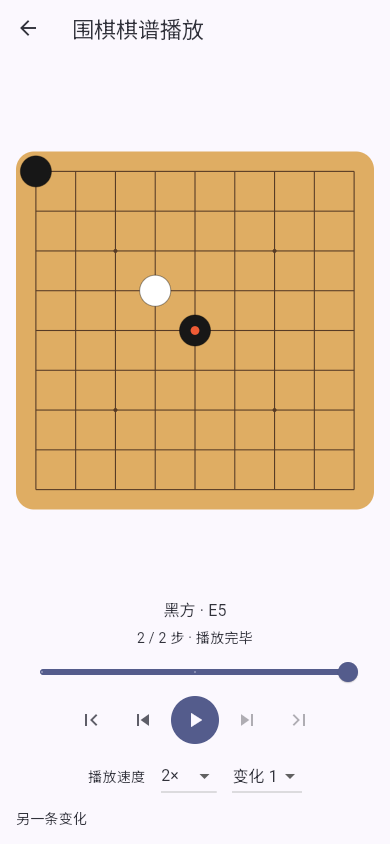
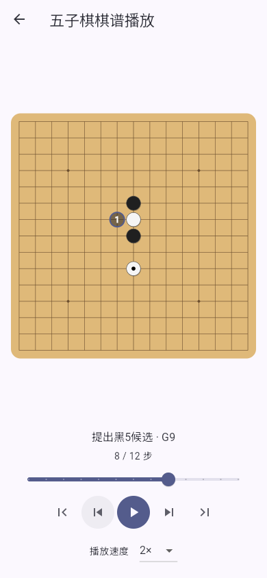
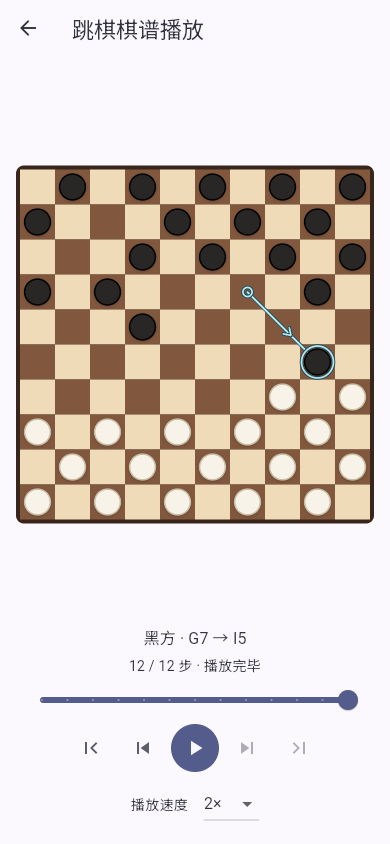
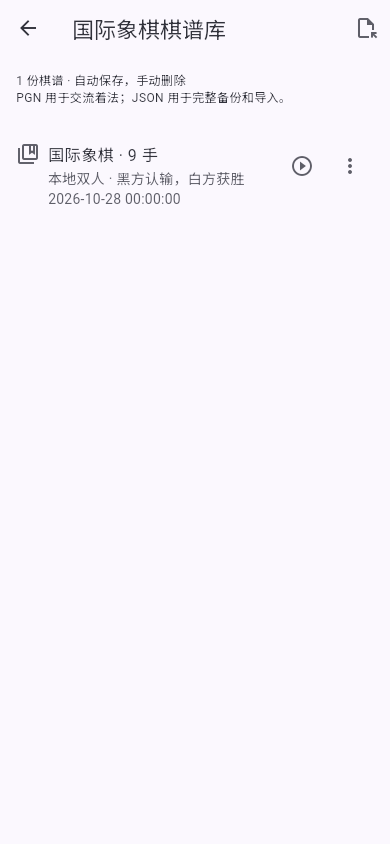
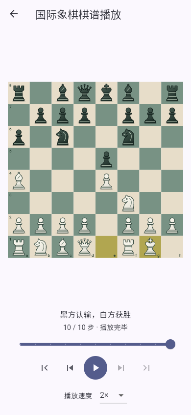
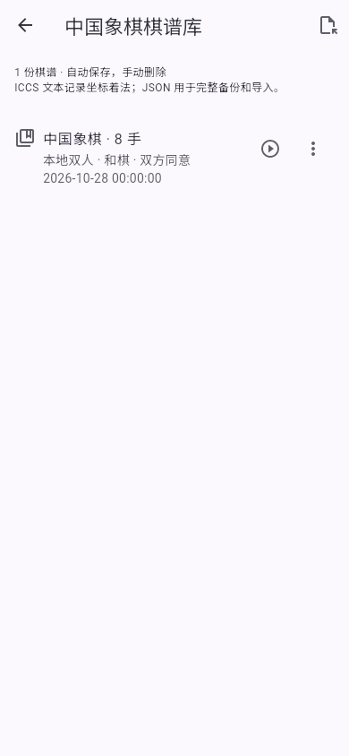
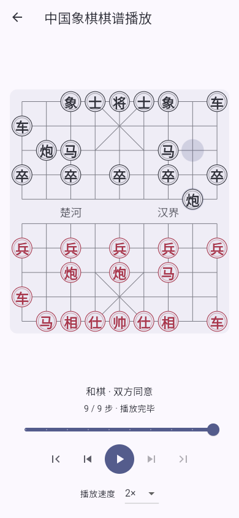
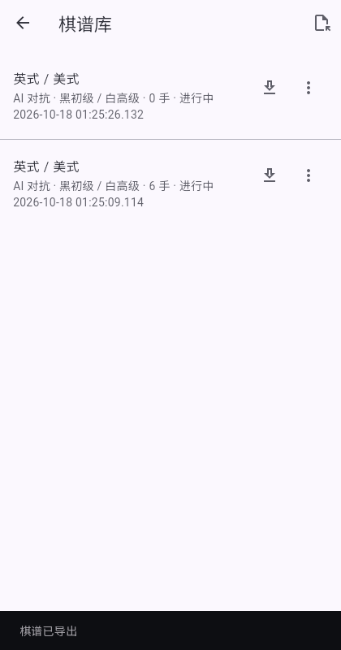
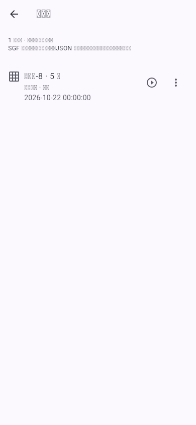
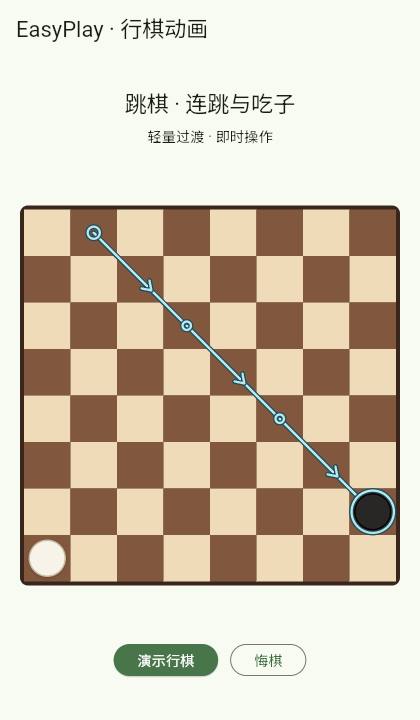

# 棋谱库与播放

在 Checkers / Draughts 或五子棋入口选择「棋谱库」，查看本机自动保存的全部棋谱。点击记录继续对局；AI 对抗记录恢复后暂停，旧五子棋规则只读打开。删除需要确认。

围棋入口的「棋谱库」同样支持播放，包含本机保存和导入的 SGF。

国际象棋和中国象棋入口也提供「棋谱库」，自动保存本地、人机和联机对局。未完成的本地、人机记录可继续，保留执棋方、AI 难度与悔棋历史；已结束和联机记录点击后进入只读播放。重新开局、联机再来一局均保留旧棋谱，新一盘另存。尚未走子的新对局不占用棋谱库；保存过的棋谱悔棋到开局后仍保留。每条记录的菜单支持导出和确认删除，顶部可导入 JSON 完整备份，导入副本使用新 ID。

## 播放

五个棋谱库的每条记录均提供「播放棋谱」按钮。播放从初始局面开始，按播放键自动推进；支持暂停、上一步 / 下一步、回到开局、跳到末尾和拖动进度条，速度可选 0.5×、1×、2×。播放到末尾后自动暂停，再按播放键可从头重播。

- 围棋保留让子、局面设置、停着、注释和图形标记；有 SGF 分支时可选择主线或其他变化，切换后从初始局面播放。
- 五子棋按完整操作顺序展示索索夫-8 的两次交换、打点数声明、候选点、选定黑5和停着；旧规则棋谱、本地、人机和 AI 对抗记录均可播放。
- 跳棋保留八种规则的完整行棋路径、连续吃子、升王与终局，支持本机和导入 PDN 的棋谱；当前一步沿用棋盘的行棋动画和上一手轨迹。
- 国际象棋保留初始 FEN、王车易位、吃过路兵、升变、重复和终局原因，以 SAN 显示当前着法；认输、协议和棋及申请和棋单独显示终局一步。
- 中国象棋保留初始 FEN、完整坐标着法、长将/长捉判罚和无吃子计数；认输、协议和棋单独显示终局一步。

手动跳步、切换变化、切出应用会暂停自动播放；回到应用后需再次按播放键。离开播放页会停止计时。播放期间棋盘只读，不运行 AI、不修改原棋谱或继续对局的位置，也不产生新存档。点击棋谱行仍按原方式继续对局。

围棋棋谱编辑页的「更多」、其余四种棋类对局的顶部也提供「播放棋谱」入口。查看当前对局时先暂停 AI，返回后恢复正常对局。

跳棋的「导出 PDN」位于棋谱行的「棋谱操作」菜单中。

  

沿用已有存储键和记录格式，旧记录不需要迁移。不再只显示20条，也不再按100盘（五子棋）或500盘（跳棋）自动淘汰旧棋谱。记录保存在设备或当前浏览器中，清除应用数据或浏览器数据仍会删除它们。

国际象棋、中国象棋以前没有持久化棋谱，加入此功能后的对局才会保存。新增存储键为 `easyplay.chess.records.v1`、`easyplay.xiangqi.records.v1`，两者独立，均保留全部记录。完整备份包含版本、棋种、对局模式、时间、执棋方、AI 难度、初始 FEN、着法和终局；规则版本不匹配或非法着法会拒绝恢复/导入。文件导入限 5 MB，只接受本棋种的 EasyPlay JSON 格式。

 

 

## 导出

Android 使用系统文件保存窗口；Web 触发浏览器下载。文件名包含棋种、创建时间和记录标识。取消保存不会删除或修改棋谱，保存失败会显示错误。

| 游戏 | 格式 | 内容 |
| --- | --- | --- |
| 跳棋 | PDN（`.pdn`） | 八种规则的规则标头、日期、结果、完整行棋路径；连续吃子包含每个落点，可通过棋谱库的 PDN 导入重新打开 |
| 五子棋 | SGF（`.sgf`，GM[4]） | 规则、日期、执棋者、结果、正式落子和停着，供支持五子棋的 SGF 阅读器使用 |
| 五子棋 | JSON（`.json`） | 完整 EasyPlay 记录：交换、候选数量、全部候选点、选点、停着、棋手身份、AI 设置及未完成的开局阶段 |
| 国际象棋 | PGN（`.pgn`） | 标准 SAN 着法、日期、双方、结果，非标准起始局面附 SetUp/FEN；当前仅导出 |
| 中国象棋 | ICCS 文本（`.txt`） | 逐手起终点坐标（如 `H2-E2`）、初始 FEN、规则版本和结果；当前仅导出 |
| 国际象棋 / 中国象棋 | JSON（`.json`） | 完整 EasyPlay 备份，可导入同棋种棋谱库，恢复规则历史与对局设置 |

SGF 没有通用属性表达索索夫-8的全部开局决策，因此 SGF 仅输出最终选中的第五子，不把未选中的候选点当作正式落子。需要保留完整开局信息时导出 JSON；当前五子棋界面尚未提供文件导入。

新 PDN 使用完整 `GameType` 描述棋盘与坐标方式，并按对应规则的先手方记分（国际跳棋使用 `2-0` / `0-2` / `1-1`），俄罗斯规则使用 `:` 表示吃子。`[EasyPlayNotationVersion "2"]` 标头用于区分新旧记分；旧版无此标头和 `GameType` 的 EasyPlay 文件继续按旧记分读取，本地存档的结果含义不变。

## 跳棋上一手轨迹

棋盘以箭头显示上一手走子的方向，并标记起点、中间落点和终点。连续吃子的所有分段都保留，包括回到起点的王棋路径。轨迹独立于下一手选点，适用于本地、人机、AI 观战及联机棋盘；翻转棋盘时同步翻转，悔棋、重开及恢复棋谱时跟随实际历史更新。

轨迹是静态提示，开启系统减少动态效果后仍会显示。

